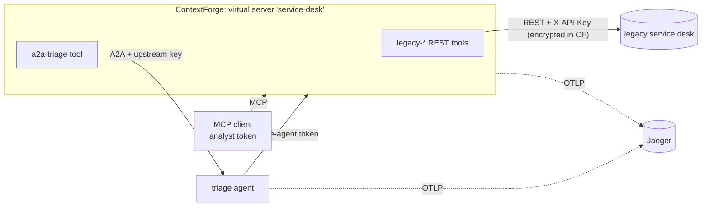

# ibm-contextforge-legacy

Wraps a **legacy REST service** as MCP tools behind **IBM ContextForge**
(`mcp-context-forge` 1.1.0), adds an **A2A triage agent** that ContextForge also
publishes as a tool, and secures the whole path with scoped JWTs, RBAC and
**OpenTelemetry traces in Jaeger**. Aimed at the IBM Software Developer role:
it's built on IBM's own gateway.



## What it demonstrates

| | |
|---|---|
| REST → MCP without touching the legacy code | `openapi_tools.py` turns allowlisted OpenAPI operations into ContextForge REST tools: path templates (`/assets/{asset_id}`), query parameters and JSON bodies. `DELETE /assets/{id}` isn't on the allowlist, so no agent can call it ("Unknown tool"), whatever its prompt says. |
| Secrets stay in the gateway | The legacy `X-API-Key` is registered as an `authheaders` credential, encrypted at rest and masked (`*****`) in every API response. Agents and clients never see it. |
| Scoped identities | `register.py` creates non-admin service users, gives them a custom `mcp-tool-user` role (`servers.read/use`, `tools.read/execute`, nothing else), and mints tokens scoped to the one virtual server. ContextForge rejects tokens for unknown users (`REQUIRE_USER_IN_DB`) and denies `tools/call` without `tools.execute`. |
| An A2A agent as an MCP tool | ContextForge wraps the registered agent as `a2a-triage`. ContextForge presents an upstream key (also stored encrypted) on every call to the agent, and the agent rejects requests without it, so a direct call gets 403. |
| Traces | ContextForge spans (`tool.invoke`, `tool.gateway_call`, …) and the agent's spans land in Jaeger, linked across services. |

## Run with Docker Compose (verified)

```bash
cd deploy
cp .env.example .env        # fill every value; passwords: 12+ chars, no "abc"/"123" runs
docker compose up --build -d
docker compose logs register          # prints the virtual server's MCP endpoint
docker compose exec triage cat /shared/cf_tokens.json   # scoped tokens (analyst, triage-agent)
# call triage from the host (endpoint uses http://localhost:4444/servers/<id>/mcp)
open http://localhost:16686           # Jaeger: services "contextforge" and "triage-agent"
```

Three ContextForge 1.1.0 container gotchas this setup handles, each found by running it:
1. The image runs as UID 10001, and a fresh named volume is root-owned, so SQLite can't create its file and startup hangs silently. The `cf-volume-init` service fixes ownership first.
2. The image defaults to up to 16 gunicorn workers. With SQLite, use `GUNICORN_WORKERS=1`, or switch to Postgres before raising it.
3. With `OTEL_EXPORTER_OTLP_PROTOCOL=http`, ContextForge uses the endpoint as-is, so it needs the full `.../v1/traces` path. The standard OTel SDK in the agent wants only the base URL.

## Run locally without Docker

```bash
uv venv -p 3.13 && uv pip install -e ../agent-mesh-core -e '.[dev,gateway]'
export JWT_SECRET_KEY=... AUTH_ENCRYPTION_SECRET=... PLATFORM_ADMIN_PASSWORD=... DEFAULT_USER_PASSWORD=...
export MCPGATEWAY_ADMIN_API_ENABLED=true SSRF_ALLOW_LOCALHOST=true SSRF_ALLOW_PRIVATE_NETWORKS=true
export LEGACY_API_KEY=... AGENTMESH_UPSTREAM_KEY=...
mcpgateway --host 127.0.0.1 --port 4444 &
python -m uvicorn legacybridge.legacy_api:app --factory --port 9300 &
python -m agentmesh.serve legacybridge.triage:app --port 9310 &   # reads .cf_tokens.json per request
legacybridge register            # tools + agent + virtual server + scoped tokens -> .cf_tokens.json
legacybridge triage INC-5001     # as the analyst, through ContextForge
```

## Tests

```bash
.venv/bin/pytest                                   # 10 unit tests (+4 live tests, skipped)
CONTEXTFORGE_LIVE=1 .venv/bin/pytest tests/test_contextforge_live.py   # against a running stack
```

The live tests passed against ContextForge 1.1.0. They cover idempotent
re-registration, a scoped token seeing only allowlisted tools, a missing token
being rejected, and triage through ContextForge writing its note back to the
legacy system.

## Upstream contribution

The previous planning conversation found that ContextForge's docs list Python
3.10/3.11 while `pyproject.toml` requires `>=3.12,<3.14`, so the quick start
fails on 3.11. Building this project confirmed the requirement in practice
(`pip install mcp-contextforge-gateway` only resolves on 3.12/3.13). For the
docs PR: search existing issues first, open one, and sign every commit with
`git commit -s` (their DCO rule).
